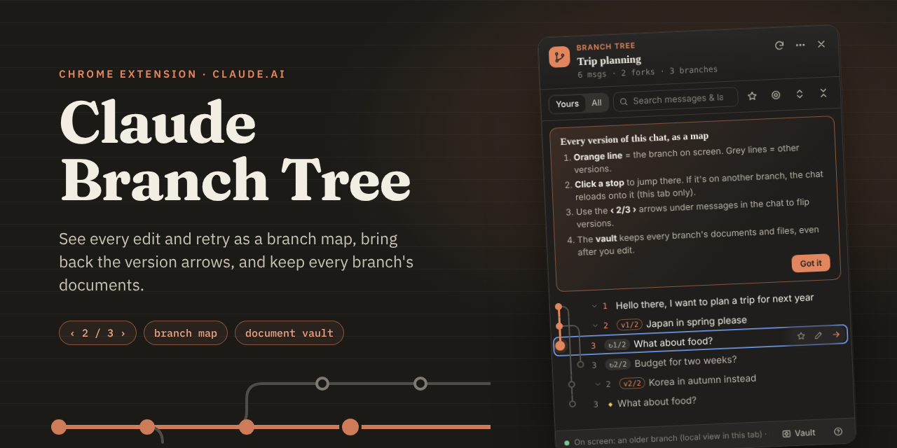
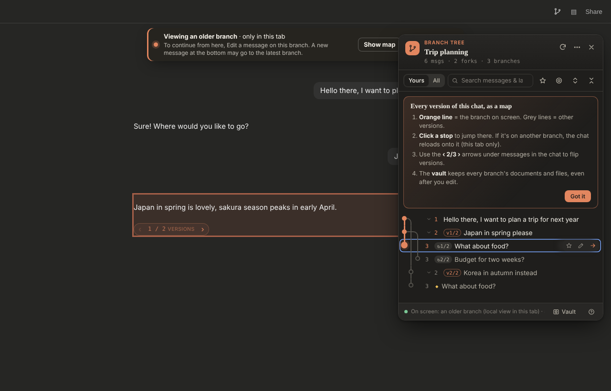
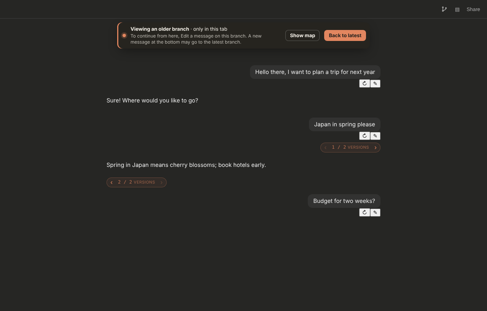
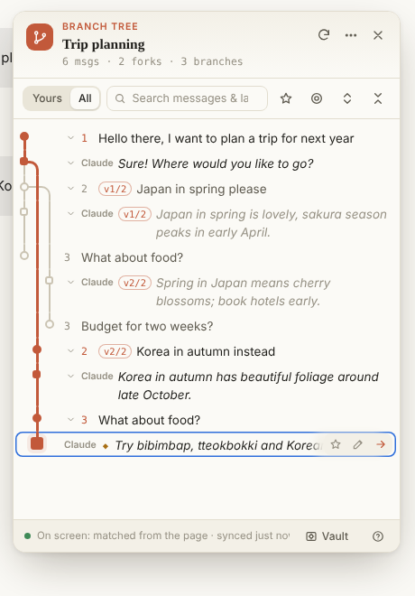
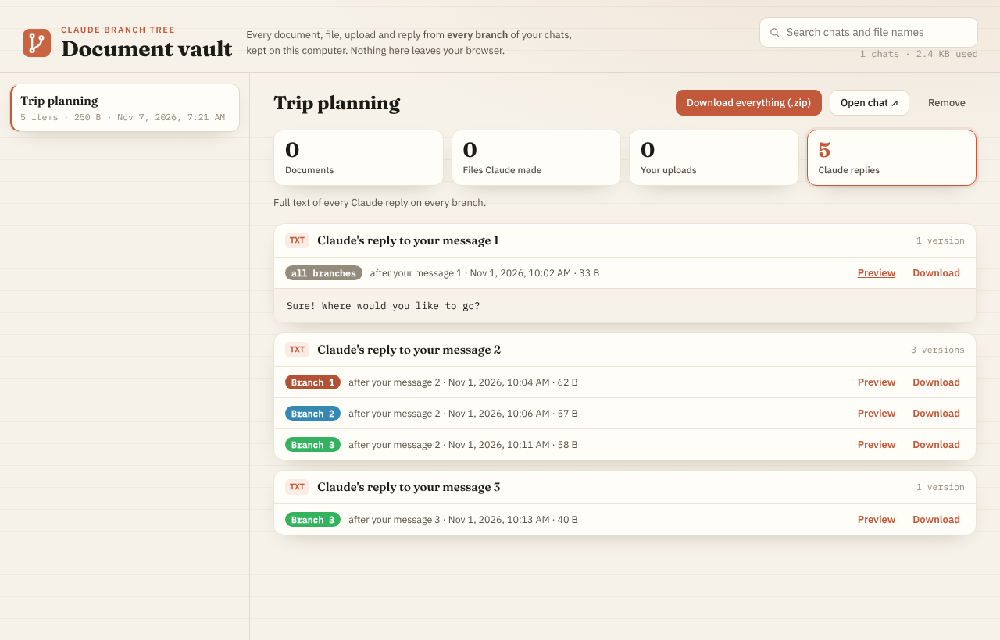

<p align="center"></p>

<p align="center">
  <a href="https://github.com/Architect-Of-Infinity/claude-branch-tree/actions/workflows/test.yml"></a>
  <a href="https://github.com/Architect-Of-Infinity/claude-branch-tree/releases/latest"></a>
  
  <a href="LICENSE"></a>
</p>

# Claude Branch Tree

A Chrome extension for **claude.ai**: see every edit and retry of a chat as a branch map, switch to any version, and keep every document from every branch.

> Not affiliated with Anthropic. Uses claude.ai's internal, unofficial web API, which can change at any time; see *When claude.ai changes again*.

**Version 2.2.0** · [Changelog](CHANGELOG.md) · [Privacy](PRIVACY.md) · [Contributing](CONTRIBUTING.md)

- **Branch map**: every message is a stop; the branch on screen is the bold line.
- **Version arrows are back**: claude.ai's new layout removed them; the extension adds `‹ 2/3 ›` under every message with versions.
- **Document vault**: every document, file, upload and reply from every branch, kept on your computer.
- **Exports**: one branch, every branch, outline, raw JSON, or the vault as .zip.

| Branch map | In the chat | Light mode |
|---|---|---|
|  |  |  |



Rebuilt from the Tampermonkey userscript [*Claude Branch Tree Viewer*](https://github.com/Sc5N6A9L/claude-branch-tree-viewer) by Sc5N6A9L (MIT).

---

## Install (Chrome, Edge, Brave)

1. Download **`claude-branch-tree-2.2.0.zip`** from [**Releases**](https://github.com/Architect-Of-Infinity/claude-branch-tree/releases/latest) and unzip it somewhere permanent, e.g. `C:\Tools\claude-branch-tree\`.
2. `chrome://extensions` → turn on **Developer mode**.
3. **Load unpacked** → select the unzipped folder (the one with `manifest.json` inside).
   *(From source instead: clone the repo and pick its `extension/` folder.)*
   Updating from 2.0? Click **Remove** on the old card first, or replace the folder's files and click ↻.
4. **Reload your claude.ai tabs** (F5).
5. Turn off the old Tampermonkey userscript.

## What it does

| Feature | How |
|---|---|
| **Version arrows** | `‹ 2/3 ›` appears under every message (yours or Claude's) that has other versions. Hover to preview the neighbour, click to switch |
| **Branch map** | Branch icon in the chat header, the extension icon, or **Alt+B**. *Yours / All* shows only your messages or Claude's replies too |
| **Document vault** shortcut | Extension icon on any non-claude.ai tab, or the panel's **Vault** button |
| **Go to any message** | Click a row. It's on screen → scrolls there. On another branch → switches to it |
| **Labels / stars / search** | Double-click or F2 to label · ☆ or S to star · `/` to search all text and labels |
| **Document vault** | Every document, shared file, upload and reply from **every** branch, saved on this computer. Panel ⋯ → *Document vault* |
| **Export** | Panel ⋯ → on-screen branch (.md) · **every branch, full text (.md)** · tree outline · raw JSON · vault → **everything as .zip** |

### How switching works now (important)

claude.ai's new layout (checked live, 7 Nov 2026) has **no version arrows**, and its server **ignores**
"set current branch" for new-style chats (tested: request accepted, nothing changed). So the extension:

1. remembers which branch you picked and **reloads the chat**;
2. as the page loads, swaps **one value** in the chat's load data (the ID of the branch's last
   message) for the branch you picked. IDs are always 36 characters, so the swap doesn't change
   the data's length or anything else in it;
3. the page draws your branch, with an orange **"Viewing an older branch"** bar at the top.

- **Only this tab** sees it. Nothing on your account changes; other devices and tabs show the latest branch.
- **A normal reload goes back to the latest branch.** So does the bar's *Back to latest* button.
- **To continue from an older branch, use Edit** on a message in that branch (that creates a new
  version from there). A brand-new message typed at the bottom **may attach to the latest branch
  instead**; this hasn't been tested.

On the older claude.ai layout (with its own arrows), the extension clicks those arrows instead, with no reload.

### Document vault

claude.ai's new layout gives you no way back to an old branch, so files and documents from those
branches become unreachable. The vault saves them as you open each chat:

| Tab | What | Source |
|---|---|---|
| Documents | Text files Claude wrote, **one version per branch**, rebuilt from the file-tool calls kept in the chat history (`Write`, `create_file`, `str_replace`, artifacts…) | chat history (works for old chats too) |
| Files Claude made | The actual shared files (download cards). claude.ai keeps **each share as its own copy**, so every branch's file is downloadable | `/files/<id>/contents` |
| Your uploads | Files you attached | `/files/<id>/contents` |
| Claude replies | Full text of every reply on every branch | chat history |

Stored in `chrome.storage.local` with `unlimitedStorage`, deduplicated by SHA-256, files over 25 MB
skipped. Settings → *Document vault* to turn off. **Uninstalling the extension deletes the vault**,
so download the .zip first.

---

## Failure behaviour

| Situation | What happens |
|---|---|
| Switch reload doesn't take effect (claude.ai changed its load format) | After 15 s the bar says *couldn't switch*; you're on the latest branch; Diagnostics shows `Last switch: missed` |
| A file can't be downloaded for the vault | Skipped; counted in the toast and Diagnostics; retried next time you open the chat |
| Layout changes, messages can't be read | Panel falls back to the server's latest branch; arrows aren't shown |
| API error / timeout (15 s) | Previous tree stays; footer shows the error |
| Not on a chat page | Nothing runs except the hidden passive hook |

**Writes to your account: none.** The only network calls are reads (the conversation tree and file
downloads) made with your own login. The page hook only rewrites what *your tab* receives, and only
right after you asked to switch.

## When claude.ai changes again

Panel → ⋯ → **Diagnostics** → *Copy as JSON*, and paste it to Claude together with:
- `extension/src/dom.js` (all page selectors are in `SEL` at the top), and/or
- `extension/src/page-hook.js` (the load-time swap).

## Tests

```bash
cd tests
npm install
npm test                    # 40 tests: tree logic, page hook (byte swap, gzip frames), vault, simulated pages
node chrome-newlayout.js    # real Chrome + extension vs. a fake claude.ai built like the live one (12 steps)
node chrome-smoke.js        # real Chrome vs. the older layout with native arrows
```
The Chrome scripts expect Chrome for Testing at `/usr/bin/google-chrome` (edit `executablePath` on Windows).

## Verified live on claude.ai (7 Nov 2026)

- Message rows: `[data-cds="UserMessage"][data-turn-key=<your message id>]`, `[data-cds="AssistantMessage"]`; no version arrows; actions are only Retry / Edit / Copy.
- Chats load through `ConversationService/StreamTimeline` (binary protobuf); the branch ID sits in field 7 (`0x3A 0x24` + 36 bytes) exactly once. With `connect-accept-encoding: gzip` the server compresses frames, so the hook removes that header (and can unzip frames itself as a backup).
- `PerformAction set_current_leaf` returns 200 but changes nothing on new-style chats.
- Claude's file tools appear as `Write` (`file_path`, `content`) and `SendUserFile` (`files`); shared files sit in the reply's `files[]` with their own `file_uuid`; `/files/<id>/contents` → 200.
- `lastActiveOrg` cookie is readable by page scripts.

## Privacy

Everything stays in your browser. No servers, analytics or tracking; nothing is written to your claude.ai account. See [PRIVACY.md](PRIVACY.md).

## Credits & licence

MIT. Based on *Claude Branch Tree Viewer* by Sc5N6A9L (MIT). Fonts on the vault and settings pages: Fraunces and IBM Plex, SIL Open Font License 1.1 (`extension/fonts/`).

## Not verified yet

- **The reload-switch end to end on claude.ai itself.** Each part was checked separately against the live
  site, and the whole flow was tested in real Chrome against a copy built like it. If a switch fails, a red
  bar says so and Diagnostics shows `Last switch: missed`.
- Whether a new message typed while viewing an older branch attaches to that branch or to the latest one.
- Very long chats, where the page loads in pieces (the swap only needs the first snapshot, but this is untested).
- Alt+B (Chrome shortcuts can't be tested headless).
